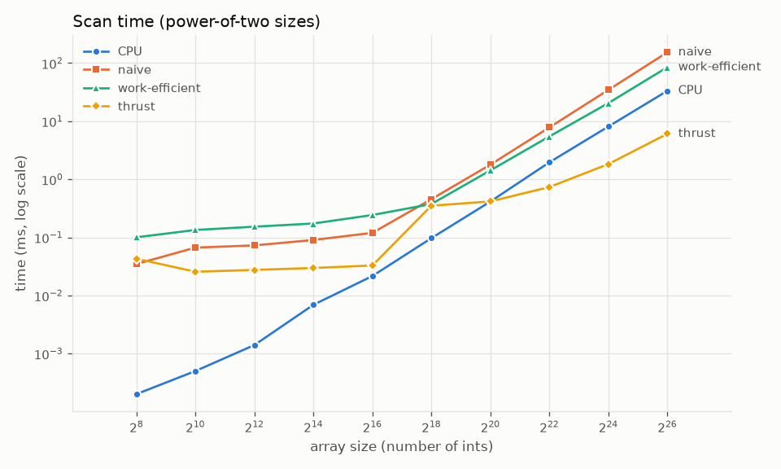

CUDA Stream Compaction
======================

**University of Pennsylvania, CIS 565: GPU Programming and Architecture, Project 2**

* Chen Cheng
  * [LinkedIn](https://www.linkedin.com/in/chen-andrew-cheng-34a133229/), [GitHub](https://github.com/ischencheng)
* Tested on: Windows 11, i5-12500H @ 2.50GHz 16GB, NVIDIA GeForce RTX 2050 4GB (personal laptop)

### Description

Stream compaction removes the elements I don't want from an array and packs the rest together. Here the elements to remove are the `0`s in an array of `int`s. The main building block is scan (prefix sum). In an exclusive scan each output element is the sum of all input elements before it, for example `[1 5 0 1 2 0 3]` becomes `[0 1 6 6 7 9 9]`.

Features:

* CPU scan, and CPU compaction with and without scan
* Naive GPU scan
* Work-efficient GPU scan and compaction
* Scan with Thrust
* Command line options for the array size and the block size

### CPU Scan and Compaction

The CPU scan is one `for` loop that keeps a running sum. `compactWithoutScan` copies every non-zero element to the next free slot of the output. `compactWithScan` does it the way the GPU will do it, in three steps: map each element to 1 if I keep it and 0 if not, scan this 0/1 array, and write each kept element to the index that the scan gives (scatter).

### Naive Scan

The naive scan runs log2(n) levels. At level d every element adds the element 2^(d-1) places to its left, so after the last level each element holds the sum of everything up to and including itself. A thread can't safely read an element that another thread is writing, so I use two buffers and swap them after each level. To get an exclusive scan I shift the input right by one when I copy it to the GPU. This needs O(n log n) additions in total.

### Work-Efficient Scan and Compaction

The work-efficient scan treats the array as a balanced binary tree. In the up-sweep each level adds the left child into the right child, so the last element ends up with the total sum. Then I set the last element to 0. In the down-sweep each node gives its value to its left child, and its value plus the old left child to its right child. This needs only O(n) additions and works in place. The tree needs a power-of-two size, so I pad the array with zeros to the next power of two.

Compaction on the GPU has the same three steps as on the CPU: `kernMapToBoolean`, the work-efficient scan and `kernScatter`. The number of kept elements is the last scan value plus the last 0/1 value.

### Thrust

This is just `thrust::exclusive_scan` on two `thrust::device_vector`s. The copies to and from the GPU are outside the timer, like in my own versions.

### Performance Analysis

I added two command line options, so I don't have to recompile for every test: `-pow 20` runs the tests with 2^20 elements, and `-block 256` sets the block size of all my GPU versions. Before the tests the program runs every GPU version once, so loading the kernels is not part of the timing. All numbers are from a Release build. I ran each setting 3 times and took the middle run. Below 1 ms the numbers jump around a lot between runs (often by 15%, sometimes 2×), above 1 ms they are within a few percent.

This table shows the time in ms with 2^22 elements for different block sizes.

| block size | 32 | 64 | 128 | 256 | 512 | 1024 |
| --- | --- | --- | --- | --- | --- | --- |
| naive scan | 8.65 | 7.76 | 7.80 | 7.80 | 7.86 | 7.79 |
| work-efficient scan | 13.67 | 8.13 | 4.99 | 4.99 | 5.88 | 7.65 |
| work-efficient compact | 14.96 | 8.61 | 6.20 | 6.21 | 6.90 | 8.85 |



This table shows the scan time in ms (power-of-two sizes, block size 128). The non-power-of-two sizes (2^n - 3) take almost the same time, so I only show the power-of-two ones.

| size | CPU | naive | work-efficient | thrust |
| --- | --- | --- | --- | --- |
| 2^8 | 0.0002 | 0.035 | 0.100 | 0.043 |
| 2^16 | 0.022 | 0.120 | 0.242 | 0.033 |
| 2^18 | 0.097 | 0.454 | 0.375 | 0.350 |
| 2^20 | 0.414 | 1.79 | 1.42 | 0.416 |
| 2^22 | 1.96 | 7.81 | 5.46 | 0.734 |
| 2^26 | 33.3 | 154 | 84.9 | 6.06 |

From the table, thrust is the fastest GPU version and the only one that beats the CPU, 5.5× faster at 2^26. My naive and work-efficient scans are slower than the CPU at every size. The work-efficient scan does fewer additions than the naive one, but it is only 1.8× faster at 2^26, and for small arrays it is even slower than naive, because it has twice as many kernel launches.

This table shows the compaction time in ms.

| size | CPU without scan | CPU with scan | work-efficient |
| --- | --- | --- | --- |
| 2^8 | 0.0008 | 0.0008 | 0.161 |
| 2^16 | 0.147 | 0.272 | 0.334 |
| 2^18 | 0.591 | 1.12 | 0.508 |
| 2^20 | 2.36 | 4.56 | 1.73 |
| 2^22 | 9.38 | 17.4 | 6.21 |
| 2^26 | 153 | 279 | 104 |

Compaction on the GPU wins from 2^18 on, even with my slow scan, and the scan is most of its time (84.9 of 104 ms at 2^26). On the CPU, compaction without scan is 4.6× slower than the CPU scan, although both are one loop over the array. I think this is because of the `if`: about a quarter of the random elements are 0, so the CPU can't guess the branch well. With scan it is 1.8× slower again, because it makes three passes over the data.

### Answer to Questions

* **Roughly optimize the block sizes of each of your implementations for minimal run time on your GPU. (You shouldn't compare unoptimized implementations to each other!)**

  The block size table is above. Naive is about the same from 64 to 1024, and work-efficient is fastest at 128 and 256, so I use 128 for both. Thrust picks its own block size. On this GPU an SM can hold at most 16 blocks and 1536 threads. So with 32 or 64 threads per block it only gets 512 or 1024 threads, and with 1024 threads only one block fits. I think naive doesn't care much because it is limited by memory anyway, while the work-efficient scan needs many threads in flight, because most of them do nothing (see below).

* **Compare all of these GPU Scan implementations (Naive, Work-Efficient, and Thrust) to the serial CPU version of Scan. Plot a graph of the comparison (with array size on the independent axis). We wrapped up both CPU and GPU timing functions as a performance timer class for you to conveniently measure the time cost. We use `std::chrono` to provide CPU high-precision timing and CUDA event to measure the CUDA performance. For CPU, put your CPU code between `timer().startCpuTimer()` and `timer().endCpuTimer()`. For GPU, put your CUDA code between `timer().startGpuTimer()` and `timer().endGpuTimer()`. Be sure not to include any initial/final memory operations (`cudaMalloc`, `cudaMemcpy`) in your performance measurements, for comparability. Don't mix up `CpuTimer` and `GpuTimer`. To guess at what might be happening inside the Thrust implementation (e.g. allocation, memory copy), take a look at the Nsight timeline for its execution. Your analysis here doesn't have to be detailed, since you aren't even looking at the code for the implementation.**

  The graph and the table are above. In the Nsight Systems timeline, every `thrust::exclusive_scan` call first calls `cudaMalloc` for some temporary memory, then launches two kernels (`DeviceScanInitKernel` and `DeviceScanKernel`), waits for them with `cudaStreamSynchronize`, and frees the memory with `cudaFree`. At 2^20 the two kernels take only about 77 µs of the 0.44 ms. The rest is the `cudaMalloc`, the `cudaFree`, and waiting for the first kernel to start. At 2^16 the same calls take only a few µs, which explains the jump of thrust between 2^16 and 2^18. My guess is that a small temporary buffer comes from memory the driver already has, and a bigger one needs a real new allocation.

* **Write a brief explanation of the phenomena you see here. Can you find the performance bottlenecks? Is it memory I/O? Computation? Is it different for each implementation?**

  Yes, it is different for each one. For small arrays all GPU versions are limited by fixed costs: each kernel launch takes a few µs, naive has log2(n) launches and work-efficient 2·log2(n). For big arrays naive is limited by memory: in each of its log2(n) levels it reads the whole array twice and writes it once. At 2^26 that is about 21 GB in total, and this GPU can move about 112 GB/s, so roughly 190 ms. I measured 154 ms, and I think some of the reads hit the cache. The work-efficient scan moves much less data, but it still launches one thread per element at every level, and at level d only one thread out of 2^(d+1) does something. So I think it is limited by the many idle threads, not by memory or computation. Thrust is limited by memory: at 2^26 it reads and writes 268 MB each in 6.06 ms, about 89 GB/s. The CPU scan is limited by being one thread, since each addition needs the result of the previous one.

* **Paste the output of the test program into a triple-backtick block in your README. If you add your own tests (e.g. for radix sort or to test additional corner cases), be sure to mention it explicitly.**

  This is the output of `cis5650_stream_compaction_test.exe -pow 20`.

  ```
  ****************
  ** SCAN TESTS **
  ****************
      [  19   9   9  24  16  30   5  30  47  49  23  33  27 ...  11   0 ]
  ==== cpu scan, power-of-two ====
     elapsed time: 0.4058ms    (std::chrono Measured)
      [   0  19  28  37  61  77 107 112 142 189 238 261 294 ... 25672088 25672099 ]
  ==== cpu scan, non-power-of-two ====
     elapsed time: 0.3741ms    (std::chrono Measured)
      [   0  19  28  37  61  77 107 112 142 189 238 261 294 ... 25672029 25672044 ]
      passed
  ==== naive scan, power-of-two ====
     elapsed time: 1.79347ms    (CUDA Measured)
      passed
  ==== naive scan, non-power-of-two ====
     elapsed time: 1.79178ms    (CUDA Measured)
      passed
  ==== work-efficient scan, power-of-two ====
     elapsed time: 1.5176ms    (CUDA Measured)
      passed
  ==== work-efficient scan, non-power-of-two ====
     elapsed time: 1.52038ms    (CUDA Measured)
      passed
  ==== thrust scan, power-of-two ====
     elapsed time: 0.434016ms    (CUDA Measured)
      passed
  ==== thrust scan, non-power-of-two ====
     elapsed time: 0.466816ms    (CUDA Measured)
      passed

  *****************************
  ** STREAM COMPACTION TESTS **
  *****************************
      [   0   2   1   1   3   1   1   3   2   1   1   1   2 ...   3   0 ]
  ==== cpu compact without scan, power-of-two ====
     elapsed time: 2.3316ms    (std::chrono Measured)
      [   2   1   1   3   1   1   3   2   1   1   1   2   1 ...   2   3 ]
      passed
  ==== cpu compact without scan, non-power-of-two ====
     elapsed time: 2.1798ms    (std::chrono Measured)
      [   2   1   1   3   1   1   3   2   1   1   1   2   1 ...   1   3 ]
      passed
  ==== cpu compact with scan ====
     elapsed time: 4.2614ms    (std::chrono Measured)
      [   2   1   1   3   1   1   3   2   1   1   1   2   1 ...   2   3 ]
      passed
  ==== work-efficient compact, power-of-two ====
     elapsed time: 1.81965ms    (CUDA Measured)
      passed
  ==== work-efficient compact, non-power-of-two ====
     elapsed time: 1.81862ms    (CUDA Measured)
      passed
  ```

### Extra Credit: Faster Work-Efficient Scan

My first work-efficient scan launched one thread per element at every level, and a thread only did something if its index was a multiple of 2^(d+1). So at the deeper levels almost every thread just checked its index and quit. Now thread k works on the k-th pair of the level, so a level only launches n / 2^(d+1) threads. A whole scan now launches about 2n threads instead of 2n·log2(n).

This table shows the work-efficient scan in ms before and after this change.

| size | CPU | before | after |
| --- | --- | --- | --- |
| 2^16 | 0.022 | 0.242 | 0.212 |
| 2^18 | 0.097 | 0.375 | 0.288 |
| 2^20 | 0.414 | 1.42 | 1.02 |
| 2^22 | 1.96 | 5.46 | 3.61 |
| 2^24 | 8.08 | 20.5 | 13.8 |
| 2^26 | 33.3 | 84.9 | 54.8 |

It is about 1.5× faster for big arrays, and compaction got faster with it (104 to 74.3 ms at 2^26). The block size doesn't matter any more: 32 to 1024 all give 3.5 to 3.7 ms at 2^22. But it is still slower than the CPU. The threads of a warp touch elements that are 2^(d+1) apart, and the GPU reads memory in pieces of 32 bytes, so from the third level on most of each piece is wasted. With Nsight Compute I measured that the 44 sweep kernels at 2^22 move 319 MB, 9.5× the 33.5 MB of one read and one write of the array. So now the scan is limited by memory.
